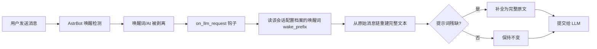

# astrbot_plugin_full_prompt


[](LICENSE)
[](https://github.com/Soulter/AstrBot)


修复 AstrBot 中**唤醒词 / @机器人 被剥离**导致提交给 LLM 的提示词残缺的问题。

## 问题现象

例如你发送 `宁宁，你在哪`，唤醒词 `宁宁` 会被 AstrBot 的唤醒检测逻辑剥离，
最终提交给大模型的提示词变成了 `，你在哪`，对话体验非常奇怪。

### 修复前 vs 修复后

| 你发送的内容 | 修复前提交给 LLM | 修复后提交给 LLM |
| --- | --- | --- |
| 宁宁，你在哪 | ，你在哪 | 宁宁，你在哪 |
| 宁宁~ | ~ | 宁宁~ |
| 甲酱 帮我看下 | 帮我看下 | 甲酱 帮我看下 |
| @机器人 帮我写首诗 | 帮我写首诗 | 宁宁 帮我写首诗 |

## 解决方案

唤醒词的**检测**本来就由 AstrBot 负责，本插件只负责**补全**：
通过 `on_llm_request` 钩子，在请求发出前从**原始消息链**重建完整文本。

- 用户原文里打过的唤醒词（任意一个别名）都会原样补回，**不需要在本插件里配置唤醒词**
- `@机器人` 用平台在 At 消息段里带的**群名片/昵称**补上——这个群当下怎么称呼它，就补什么
- 钩子**优先级最高**，所以补全发生在其它插件的 `on_llm_request` 之前：记忆召回、语气词判断等
  看到的都是补全后的完整原文
- 比对 `req.prompt` 与重建文本，只在提示词确实残缺时替换；多轮对话/工具调用不会误伤
- 支持按群排除、私聊开关

### 任意唤醒词（v1.3.0）

AstrBot 面板「配置文件」里每个 bot 可以配**一串**唤醒词，插件直接读它（`auto_wake_word`）：

```
甲名, 甲酱, 甲甲, 甲甲·乙
```

| 场景 | 结果 |
| --- | --- |
| 打 `甲酱 帮我看下` | 补全为 `甲酱 帮我看下`（任意别名都认） |
| 打 `甲甲·乙 在吗` | 补全为 `甲甲·乙 在吗`（按最长匹配识别） |
| 打 `甲名~` | 补全为 `甲名~` |
| 打了唤醒词又 @机器人 | 只保留一次唤醒词，不会出现两遍名字 |

判定用的是**消息所属的配置文件**，所以同机挂多个 bot 时各自读各自的唤醒词，
不需要再用 `bot_name_by_self_id` 逐个账号配置。

### @机器人 的名字：用平台给的，不用指定（v1.4.0）

`@机器人` 时优先用**平台在 At 里带的名字**（群名片，取不到用昵称）——
即"这个群当下怎么称呼它"，逐群自适应，**不需要任何配置**。
平台没给名字时，才按下面的顺序兜底：

```
按群 bot_name_map > 按Bot bot_name_by_self_id
> 该会话配置档案里第一个像名字的唤醒词 > bot_name > 默认为「宁宁」
```

「像名字」= 含字母/数字/汉字；`/` 这类纯符号不会被当成名字。

> 用户**自己打出来的**唤醒词永远原样保留（它本来就在原始消息链里），不走上面的优先级。

### 工作原理



## 安装

1. 将本目录放入 AstrBot 的 `data/plugins/` 下
2. 在 WebUI 插件管理页面刷新并启用插件

## 配置

| 配置项 | 类型 | 默认值 | 说明 |
| --- | --- | --- | --- |
| `auto_wake_word` | bool | `true` | 自动读 AstrBot 里该会话配置的那串唤醒词（推荐开启） |
| `bot_name` | string | `宁宁` | 最后兜底：平台没给 @ 名字、该会话也没配唤醒词时用的名字 |
| `extra_wake_words` | list | 空 | AstrBot 里没配、但本插件也想认的额外唤醒词（一般留空） |
| `bot_name_map` | list | 空 | 可选兜底，按群指定 @机器人 的名字：`群号,昵称` |
| `bot_name_by_self_id` | list | 空 | 可选兜底，按Bot账号指定名字：`QQ号,昵称` |
| `keep_at_marker` | bool | `false` | 开启后不替换为名字，保留原始 `[At:qq]` 标记 |
| `exclude_groups` | list | 空 | 不补全提示词的群号列表 |
| `enable_private` | bool | `true` | 私聊是否补全提示词 |

## 兼容性

- 支持平台：aiocqhttp
- AstrBot 版本：`>=v4.12.0`（读取配置文件唤醒词用 `context.get_config(umo)`，取不到时自动退回旧行为）

## License

MIT
