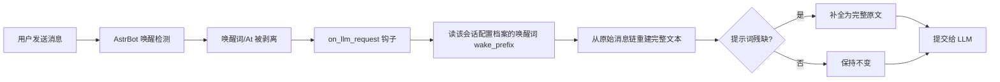

# astrbot_plugin_full_prompt


[](LICENSE)
[](https://github.com/Soulter/AstrBot)


AstrBot 做唤醒检测时，会把唤醒词和 @机器人 从消息里剥掉，模型收到的就成了半句。这个插件把剥掉的那部分补回去。

## 问题现象

AstrBot 做唤醒检测时，会把唤醒词整段剥掉再交给模型。剥掉的常常正是主语，模型收到的就成了没头没尾的一句话。

下面拿 `小助手` 当唤醒词举例，你配的是哪个名字都一样。

| 你发送的内容 | 装之前模型收到 | 装之后模型收到 |
| --- | --- | --- |
| 小助手是谁 | 是谁 | 小助手是谁 |
| 小助手喜欢吃什么 | 喜欢吃什么 | 小助手喜欢吃什么 |
| 小助手~ | ~ | 小助手~ |
| 成员A @小助手 分组名单 | 成员A 分组名单 | 成员A 小助手 分组名单 |
| @小助手 帮我写首诗 | 帮我写首诗 | 小助手 帮我写首诗 |

前三行是主语没了，模型不知道在问谁、也不知道是谁喜欢吃什么。第四行是多人名单里自己那一份没了，机器人会以为自己没被分到组。最后一行是 @ 变成了名字。

## 解决方案

唤醒词是 AstrBot 检测的，插件不插手这一步，只管补。它挂 `on_llm_request`，在请求发出之前看一眼原始消息链，把完整文本重拼一遍。

- 你打过的唤醒词，用哪个别名都原样补回，插件这边不用再写一遍唤醒词
- `@机器人` 换成平台在 At 段里带的名字，也就是这个群当时怎么称呼它。群里改了名片，补上的名字跟着变
- 别人的 @ 写成 `@昵称(qq)`，和 AstrBot 自己的写法一致，模型能看出名单里谁是谁。多重 @ 的消息里，自己那一份也会补上名字
- 钩子优先级最高，补发生在别的插件之前，记忆召回、语气判断读到的都是补全后的文本
- 只在提示词确实残缺时才动它，多轮对话和工具调用不会被误伤
- 支持按群排除、私聊关闭

### 任意唤醒词（v1.3.0）

AstrBot 面板的「配置文件」里，每个 bot 有一串唤醒词，插件直接读那串（`auto_wake_word`）：

```
甲名, 甲酱, 甲甲, 甲甲·乙
```

| 场景 | 结果 |
| --- | --- |
| 打 `甲酱 帮我看下` | 补成 `甲酱 帮我看下`，任意别名都认 |
| 打 `甲甲·乙 在吗` | 补成 `甲甲·乙 在吗`，按最长匹配 |
| 打 `甲名~` | 补成 `甲名~` |
| 打了唤醒词又 @机器人 | 只留一份，不会出现两遍名字 |

读的是消息所属的那份配置文件，所以一台机器挂多个 bot，各自读各自的，不用再拿 `bot_name_by_self_id` 一个个账号去填。

### @机器人 的名字不用指定（v1.4.0）

@ 机器人时优先用平台在 At 里带的名字，取不到再退到昵称。这个群怎么称呼它，就补什么，不用配置。

平台没给名字时，才按下面的顺序兜底：

```
按群 bot_name_map > 按Bot bot_name_by_self_id
> 该会话配置档案里第一个像名字的唤醒词 > bot_name > 默认为「宁宁」
```

「像名字」指含字母、数字或汉字，`/` 这类纯符号不算。

> 你自己打出来的唤醒词永远原样保留，本来就在原始消息链里，不走上面的优先级。

### 工作原理



## 安装

1. 将本目录放入 AstrBot 的 `data/plugins/` 下
2. 在 WebUI 插件管理页面刷新并启用插件

## 配置

| 配置项 | 类型 | 默认值 | 说明 |
| --- | --- | --- | --- |
| `auto_wake_word` | bool | `true` | 自动读 AstrBot 里该会话配置的那串唤醒词（推荐开着） |
| `bot_name` | string | `宁宁` | 最后兜底，平台没给 @ 名字、该会话也没配唤醒词时用 |
| `extra_wake_words` | list | 空 | AstrBot 里没配、但插件也想认的唤醒词，一般留空 |
| `bot_name_map` | list | 空 | 可选兜底，按群指定 @机器人 的名字，填 `群号,昵称` |
| `bot_name_by_self_id` | list | 空 | 可选兜底，按 Bot 账号指定名字，填 `QQ号,昵称` |
| `keep_at_marker` | bool | `false` | 开着就不换名字，保留原始的 `[At:qq]` 标记 |
| `exclude_groups` | list | 空 | 这些群不补全 |
| `enable_private` | bool | `true` | 私聊补不补 |

## 兼容性

只测过 aiocqhttp。AstrBot 需要 `>=v4.12.0`，因为读配置文件用了 `context.get_config(umo)`；老版本取不到会退回原来的行为。

## License

MIT
